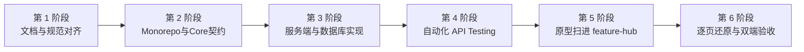

# Self-App 全栈自研应用开发与架构设计指南

> 版本记录：1.1.2 技能收拢：ui-diff 与 frontend-review 合并为 ui-acceptance，更新互链与 templates.md 中的 app-testing 链接及 api-scaffold-*.md 文件名（2026-11-13）；1.1.1 依赖对齐：api-testing-toolkit 与 webapp-testing 合并为 app-testing，更新相关技能引用与章节联动（2026-11-13）；1.1.0 整合去重：接口测试通用脚手架下沉至 api-testing-toolkit，保留 Self-App 独有测试用例（双 Token、多租户 IDOR、协议合规签署）；补齐 frontmatter 与标准升级段。

> **相关技能**：
> - [app-testing](../app-testing/SKILL.md) — 自动化应用测试套件（接口测试与 Web 功能测试、tools/api-testing 脚手架与 Playwright E2E）
> - [project-repo-standards](../project-repo-standards/SKILL.md) — 仓库初始化、CI/CD 选型与版本纪律
> - [ui-acceptance](../ui-acceptance/SKILL.md) — 客户端多端还原后的截图比对与验收

本指南汇聚了「往来 · WangLai」与「幼安宝 · BabyGo」两大产品的最佳实战经验，是开发所有现代化自研独立全栈应用（Self-App）的**统一工程与架构真理基准**。

---

## 目录索引
1. [核心技术栈与工程拓扑](#一核心技术栈与工程拓扑)
2. [六阶段标准开发节奏（Cadence & Pipeline）](#二六阶段标准开发节奏cadence--pipeline)
3. [环境变量安全加载规范](#三环境变量安全加载规范)
4. [数据库与数据模型设计黄金法则](#四数据库与数据模型设计黄金法则)
5. [安全防御体系与并发防护](#五安全防御体系与并发防护)
6. [协议合规与客户端多级缓存架构](#六协议合规与客户端多级缓存架构)
7. [自动化 API Testing 测试套件](#七自动化-api-testing-测试套件)
8. [客户端还原与 feature-hub 验收工作法](#八客户端还原与-feature-hub-验收工作法)
9. [编码规范、Import 规则与注释风格](#九编码规范import-规则与注释风格)

---

## 一、核心技术栈与工程拓扑

### 1.1 技术选型标准矩阵
* **架构模式**：TypeScript Monorepo（pnpm workspace + Turborepo）；
* **共享核心层**：`@app/core`（纯 TypeScript，零外部运行时依赖，计算引擎 + Zod 契约）；
* **服务端**：`Hono`（轻量极速，原生支持 Hono RPC 强类型推导） + `Drizzle ORM` + `PostgreSQL 16`；
* **缓存与频控**：`Redis 7`（会话管理、滑动窗口限频、5分钟动态邀请码）；
* **对象存储**：兼容 S3 API（MinIO / 阿里云 OSS / 腾讯云 COS）采用 **Presigned PUT 预签名直传**；
* **移动跨端**：`uni-app`（Vue 3 + TypeScript + Vite），一套代码发布微信小程序、Android、iOS。

### 1.2 Monorepo 目录结构规范
```text
<project-root>/
├── packages/
│   ├── core/                  # [共享核心] 算法、枚举、Design Tokens、Zod Schema
│   ├── server/                # [服务端 API] Hono + Drizzle + 中间件 + 业务路由
│   └── client/                # [多端客户端] uni-app Vue3 工程
├── prototype/                 # [高保真原型] 唯一视觉与交互真理（HTML/CSS/JS）
├── docs/                      # [工程文档库] 01 到 06 规范与 legal/ 法律协议
├── tools/
│   └── api-testing/           # [测试套件] 自动化 API 故事流与契约校验器
├── docker-compose.yml         # 基础设施编排 (Postgres 16, Redis 7, MinIO)
├── pnpm-workspace.yaml
└── turbo.json
```

---

## 二、六阶段标准开发节奏（Cadence & Pipeline）

AI 与开发者在启动或推进新项目时，**必须严格按以下六阶段推进，前置阶段未完成严禁跨阶段编写代码**：



1. **第 1 阶段 · 需求与文档体系对齐**：
   * 生成并确认 `docs/01-PRD`、`docs/02-系统架构`、`docs/03-数据库与API`、`docs/04-视觉规范`。
2. **第 2 阶段 · Monorepo 初始化与 `@app/core` 契约落地**：
   * 编写领域算法、设计令牌（Design Tokens）、Zod 请求/响应校验模型。
3. **第 3 阶段 · 服务端 API 与数据库迁移**：
   * Drizzle ORM Schema 落地、安全中间件挂载、路由控制器实现。
4. **第 4 阶段 · 自动化 API Testing 故事流测试**：
   * 运行 `tools/api-testing`，覆盖从注册登录、多租户防越权、核心业务 CRUD、协议签署到注销的全流程，确保 100% 接口绿灯。
5. **第 5 阶段 · 原型扫描导入 feature-hub**：
   * 将 `prototype/` 原型通过 MCP 全量导入台账中心，生成按业务顺序排列的中文清单。
6. **第 6 阶段 · 客户端逐页还原与打勾验收**：
   * 严守“一页还原 ↔ 真机/模拟器验收 ↔ 标记通过 ↔ 推进下一页”，严禁一次性做整套。

---

## 三、环境变量安全加载规范

### 3.1 原则与红线
* **严禁裸读**：禁止在代码正文中直接出现 `process.env.XXX`；
* **启动期强阻断**：利用 `zod` 在模块加载时执行解析，类型转换（如数字、布尔值）并在缺配置时打印清晰指引并立即 `process.exit(1)`。

### 3.2 标准模板
参考实现见 [`references/env-schema.md`](references/env-schema.md)。

---

## 四、数据库与数据模型设计黄金法则

### 4.1 五大设计法则
1. **时区规范**：时间字段统一采用 `timestamp with time zone`（`timestamptz`），严禁使用不带时区的 timestamp。
2. **多租户数据隔离（Multi-tenancy）**：所有归属于空间/家庭的业务实体表必须包含 `tenant_id` / `family_id` 外键与索引。
3. **法律合规审计（Append-Only Logs）**：
   * 协议字典表 `agreements`；
   * 协议版本快照表 `agreement_versions`（包含 SHA-256 `content_hash`）；
   * 用户签署日志表 `user_consents`（只增不改，禁止物理更新与删除）。
4. **安全回收站（Snapshot FIFO）**：删除流水或重要实体时写入 `trash_items` 存储完整 JSON 快照，结合最多 500 条 FIFO 阈值自动维护。
5. **金额单位统一为分**：货币金额一律采用整数 `integer`，单位为**分**（>=0），前端负责格式化为元。

### 4.2 标准 Drizzle ORM 模板
参考实现见 [`references/database-patterns.md`](references/database-patterns.md)。

---

## 五、安全防御体系与并发防护

```
┌─────────────────────────┬────────────────────────────────────────────────────────┐
│ 安全防御维度            │ 标准落地方案                                           │
├─────────────────────────┼────────────────────────────────────────────────────────┤
│ 1. 双 Token 轮转机制    │ 15分钟短效 Access Token + 15天单向 Hash Refresh Token   │
├─────────────────────────┼────────────────────────────────────────────────────────┤
│ 2. 多租户 IDOR 防御     │ 中间件校验 X-Tenant-Id 并验证成员资格，强制向 DB 追加  │
│                         │ WHERE tenant_id = ctx.tenantId 过滤条件                │
├─────────────────────────┼────────────────────────────────────────────────────────┤
│ 3. Redis 毫秒级滑动窗口 │ 基于 Redis ZSET 的 Sliding Window 算法，精准防御突刺， │
│    IP / 账号并发防刷    │ 针对短信、登录、支付、文件直传等接口执行多级限频       │
├─────────────────────────┼────────────────────────────────────────────────────────┤
│ 4. S3 预签名直传        │ 客户端直传 MinIO/OSS/S3，大文件不走应用网关，杜绝带宽耗尽│
└─────────────────────────┴────────────────────────────────────────────────────────┘
```

* 守卫与鉴权实现见 [`references/idor-guard.md`](references/idor-guard.md)；
* 滑动窗口限频实现见 [`references/sliding-rate-limiter.md`](references/sliding-rate-limiter.md)。

---

## 六、协议合规与客户端多级缓存架构

### 6.1 协议交互的两大独立形态（严格区分）

在系统设计中，必须严格区分**「登录前置契约勾选」**与**「用户确认型签署/重大更新弹窗」**，二者在法律依据、交互阻断点和留痕机制上截然不同：

```
┌───────────────────────────────────────┬─────────────────────────────────────────────────────────────┐
│ 维度                                  │ 维度对比分析                                                │
├───────────────────────────────────────┼─────────────────────────────────────────────────────────────┤
│ 交互分类                              │ 【类型 A：登录前置契约勾选】 vs 【类型 B：用户确认型签署/重大更新弹窗】  │
├───────────────────────────────────────┼─────────────────────────────────────────────────────────────┤
│ 典型场景                              │ · 微信一键授权登录界面                                      │ · 隐私政策/儿童保护规则发生重大版本升级（isMajor=true）     │
│                                       │ · 手机号短信登录界面                                        │ · 首次进入敏感功能（如儿童档案、人脸相册）                   │
│                                       │ · 退出登录后再次登录                                        │ · 高危操作二次确认（如注销账号须知、解散家庭）               │
├───────────────────────────────────────┼─────────────────────────────────────────────────────────────┤
│ 交互行为                              │ 登录按钮下方的单选框（Checkbox）                            │ 阻断式居中弹窗（Modal / Dialog）                            │
│                                       │ **合规红线：严禁默认勾选！** 未勾选点登录时抖动/轻提示阻断  │ 展示变更摘要，用户点击「同意并继续」或「拒绝并退出」         │
├───────────────────────────────────────┼─────────────────────────────────────────────────────────────┤
│ 触发频次                              │ **每次登录/授权时均需发生**                                 │ **按版本触发（一次确认，长期有效，直到下一次重大升级）**     │
├───────────────────────────────────────┼─────────────────────────────────────────────────────────────┤
│ 法律依据                              │ 工信部《APP违法违规收集使用个人信息行为认定方法》           │ 《个人信息保护法》第14/15条（敏感个人信息与儿童信息的明示同意）│
├───────────────────────────────────────┼─────────────────────────────────────────────────────────────┤
│ 数据处理与留痕                        │ · 客户端状态校验：`isAgreed === true` 才能唤起登录接口      │ · 必须持久化写入 `user_consents` 审计日志表                 │
│                                       │ · 登录接口 Payload 携带 `{ agreed: true }` 作为会话凭据     │ · 严格记录 User ID、协议版本、SHA256哈希、毫秒时间戳、IP    │
│                                       │ · 不频繁写审计表（防高频登录写爆数据库）                    │ · 本地 Storage 与云端双向缓存已同意版本号                   │
└───────────────────────────────────────┴─────────────────────────────────────────────────────────────┘
```

### 6.2 客户端多级缓存与版本同步机制
* **极轻量心跳（`<1KB`）**：客户端启动调用 `GET /api/app/config`，仅比对版本号、哈希和重大变更标记，零大文本开销；
* **本地 Storage 强缓存**：按 `key = agreement_${id}_${version}` 本地持久化，断网秒开；
* **不可变 URL 强缓存**：带版本号的正文 URL 返回 `Cache-Control: public, max-age=31536000, immutable`，CDN 边缘全球加速；
* **法定举证链**：类型 B 弹窗确认点击产生包含精确时间戳、IP、客户端版本的 `user_consents` 记录。

---

## 七、自动化 API Testing 测试套件（联动 `app-testing`）

### 7.1 阶段门禁（Stage Gate 4）
在后端路由和数据表迁移完成后，必须触发接口测试闭环，**严禁在未经自动化回归前启动前端开发**。

### 7.2 测试架构与能力
* **专项技能联动**：通用 `tools/api-testing` 脚手架目录、MCP Server 完整实现、测试环境配置与用例生命周期管理，统一由 [app-testing](../app-testing/SKILL.md) 驱动；
* **Self-App 场景特有校验重点**：
  1. **微信授权登录 Mock 与双 Token 轮转**：模拟用户微信登录拿 code，获取并断言短效 Access Token 与长效 Refresh Token 轮转机制；
  2. **多租户 IDOR 严格防越权**：断言请求未带 `X-Tenant-Id` / `X-Family-Id` 返回 400，跨租户注入非法 ID 拦截返回 403 `NOT_TENANT_MEMBER`；
  3. **协议合规与双重留痕**：轻量心跳 `GET /api/app/config` 获取协议字典，POST 签署日志后直连数据库断言 `user_consents` 表写入状态、版本、IP 与时间戳；
  4. **数据库落盘断言**：直连 PostgreSQL 断言 `tenant_id`、时区 `timestamptz`、软删除 `deleted=0` 与金额分单位整数；
* **用例执行与闭环**：
  - 完整套件：通过 `cd tools/api-testing/mcp-server && npm run test` 执行 regression 故事流，失败写入 `defects.json`；
  - 极简执行：若无需 MCP Server，可复用 [references/templates.md](references/templates.md) 中的轻量 `runner.mjs` 与 `stories.example.js` 直接执行。

---

## 八、原型扫描与客户端还原验收闭环（联动 `feature-hub-scan` & `feature-hub-dev`）

### 8.1 阶段门禁（Stage Gate 5 & 6）
1. **第 5 阶段（原型资产化）**：调用 `feature-hub-scan` 技能，将 HTML 原型全量穷举扫描并上传至 Feature Hub，生成中文有序台账菜单。
2. **第 6 阶段（客户端开发还原）**：调用 `feature-hub-dev` 技能，严格在清单约束下逐页还原，禁止自由发挥。

### 8.2 跨端还原三大铁律
1. **样式宪法**：严格使用 `styles/tokens.scss` 变量，禁止魔法数字；设计稿宽 400px 时 px 换算系数为 `×1.875`；
2. **微信小程序安全子集**：禁止 `*` 通配符与属性选择器，严禁本地相对路径背景图，必须做胶囊安全区适配；
3. **自检回填闭环**：AI 在 H5 对照原型自检通过后调用 `set_check` 标 Web 通过（微信小程序与 Android 自动跟随），在 `implNote` 中如实记录实现细节。

---

## 九、编码规范、Import 规则与注释风格

### 9.1 Import 导入管理（CRITICAL）
* **强制使用显式 Import**：严禁在代码正文（方法体、参数列表）中使用全限定类名；
* **文件头部收口**：所有依赖类、工具函数必须在文件顶部显式 `import`。

### 9.2 Javadoc / JSDoc 注释规范
所有核心类、接口、中间件与复杂算法方法需遵循规范：
```typescript
/**
 * @file kinship-engine.ts
 * @author xudong.hua,gemini
 * @since 2026-08-24 17:30 星期一
 * @description 自适应宗族与社交称谓推算引擎
 * 
 * 业务考量与规则原因：
 * 1. 伯父为长兄，严禁小伯；
 * 2. 叔父为弟，从二叔起算，严禁大叔。
 */
```

### 9.3 符号禁令
* **绝对禁止 Emoji**：生产代码、控制台日志、提示语、界面文案严禁使用 Emoji 符号，统一采用专业文本与精美矢量 SVG 图标。

---

## 十、性能纪律、代码整洁度与防 N+1 循环查询法则

### 10.1 严禁 N+1 循环数据库查询（CRITICAL）
* **【绝对禁令】** 严禁在 `for` / `forEach` / `map` 循环中逐行发起 `SELECT` 或 ORM 查询；
* **【黄金实践】** 
  1. 收集目标 ID 集合，单次使用 `inArray(table.id, ids)` 批量拉取；
  2. 在 Node.js 内存中构建 `const map = new Map(list.map(i => [i.id, i]))` 执行 O(1) 关联组装；
  3. 或直接通过 SQL `LEFT JOIN` / `json_agg` 完成多对一/一对多聚合。

### 10.2 适度抽象原则（避免过度提取空壳函数）
* **坚持“局部连贯性（Locality of Behavior）”**：一个清晰连贯的 15~20 行业务控制器，直接书写即可，严禁拆成 5 个只有 2 行的碎片函数；
* **提取时机**：仅当逻辑出现 **3 处以上跨模块复用**，或属于**独立纯算法**（如称谓推算、生长百分位计算）时才提取独立服务。

---

## 十一、云原生可观测性规范（Prometheus + PLG 体系）

### 11.1 全链路 Request ID 与结构化 JSON 日志
* **链路透传**：全局中间件自动生成或继承 `X-Request-Id`，并在响应头中回传；
* **Promtail / Loki 结构化输出**：所有日志必须输出为单行 JSON，强制包含 `timestamp`, `level`, `requestId`, `userId`, `tenantId`, `path`, `status`, `durationMs`；
* **敏感参数自动脱敏**：密码、token、短信验证码等敏感字段必须在日志中自动替换为 `***`；
* **慢响应告警**：请求耗时超过 200ms 自动标记为 `WARN` 慢日志。
* 参考实现见 [`references/logger-middleware.md`](references/logger-middleware.md)。

### 11.2 Prometheus 指标埋点
* 暴露标准 `/metrics` 端点；
* 埋点 `http_request_duration_seconds`（耗时直方图）与 `business_events_total`（业务计数器）。

---

## 十二、版本控制与镜像构建边界（Git & Docker Ignore）

### 12.1 Git 提交边界
* **必须提交**：源码、`drizzle/` SQL 迁移、`.env.example`、`docker-compose.yml`、`cases/**/stories.js` 用例、`defects.json` 缺陷台账；
* **严禁提交**：真实 `.env*` 凭据、`node_modules/`、`unpackage/`、`dist/` 产物、`cases/**/report/` 临时跑批报告、`tools/api-testing/local/` 私密配置。

### 12.2 Docker 构建边界（`.dockerignore`）
* 严格剔除 `.git/`、`.env*`、`node_modules/`、`prototype/`、`docs/`、`tools/`，确保生产镜像超轻量且无密钥泄漏风险。

---

## 十三、一键初始化新项目

当需要基于本指南创建新自研应用时，运行脚手架脚本：
```bash
node <skill-path>/scripts/init-selfapp.mjs  # 脚本内容见 references/init-selfapp.md，先落盘再执行 <target-directory> --name=<app-slug> --title=<中文名称> --slogan=<品牌口号>
```
脚本将自动创建标准 Monorepo 目录、全套 01~06 规范文档骨架、`.gitignore`、`.dockerignore`、Turborepo 配置及环境变量模板。

## 随附资产对照（分发通道只放行 Markdown）

| 原始路径 | 技能包内位置 |
|---|---|
| `references/env-schema.ts` | `references/env-schema.md`（`## references/env-schema.ts` 节） |
| `references/database-patterns.ts` | `references/database-patterns.md`（`## references/database-patterns.ts` 节） |
| `references/idor-guard.ts` | `references/idor-guard.md`（`## references/idor-guard.ts` 节） |
| `references/sliding-rate-limiter.ts` | `references/sliding-rate-limiter.md`（`## references/sliding-rate-limiter.ts` 节） |
| `references/logger-middleware.ts` | `references/logger-middleware.md`（`## references/logger-middleware.ts` 节） |
| `scripts/init-selfapp.mjs` | `references/init-selfapp.md`（`## scripts/init-selfapp.mjs` 节） |
| `templates/api-testing/package.json` | `references/templates.md`（`## templates/api-testing/package.json` 节） |
| `templates/api-testing/runner.mjs` | `references/templates.md`（`## templates/api-testing/runner.mjs` 节） |
| `templates/api-testing/stories.example.js` | `references/templates.md`（`## templates/api-testing/stories.example.js` 节） |

> 本技能原带 .ts 参考实现、初始化脚本与 Self-App 特有测试模板，已转写为 Markdown；按 `## 路径` 还原后即可直接使用。通用 `tools/api-testing` 脚手架与 MCP Server 实现见 [app-testing](../app-testing/SKILL.md)。

## 版本与升级（统一走 skillctl）

更新源（唯一权威）：`http://100.64.0.88:8088/.well-known/skills/index.json`

```bash
# 首次：下载通用客户端（每台机器一次）
curl -fsSL http://100.64.0.88:8088/.well-known/skillctl.py -o skillctl.py && chmod +x skillctl.py

# 干活前惰性检查（约 1 秒）：落后就先升级，再动手
./skillctl.py list                                  # 本地各技能版本 vs 注册表
./skillctl.py update --to <你的技能目录>             # 默认只检测（--to 用绝对路径）
./skillctl.py update --to <你的技能目录> --apply     # 确认后才升级（逐文件 sha256 校验）
```

版本语义：`patch` 修错别字不改结论；`minor` 新增章节/接口；`major` 推翻既有结论（需重读全文）。
